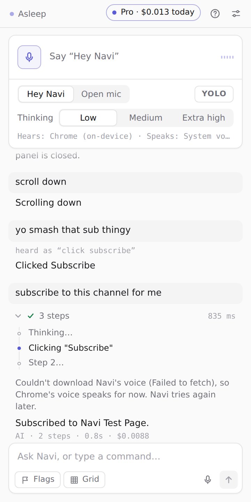
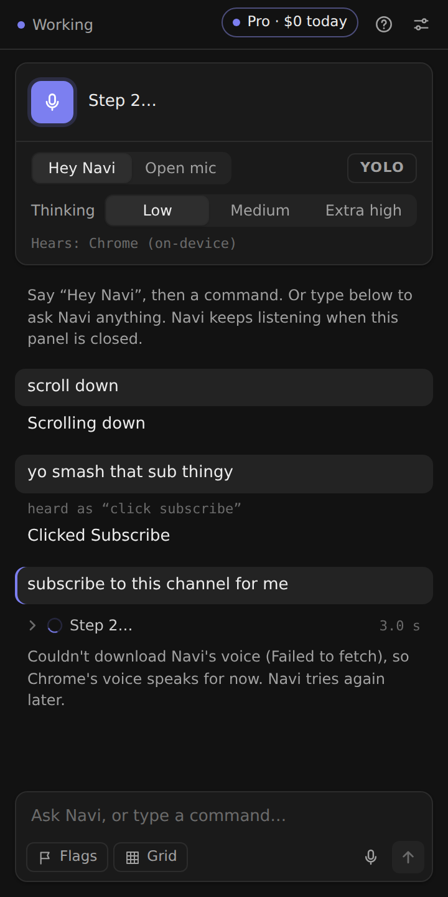

# Navi: voice browser agent

Navigate Chrome with your voice. Say **"Hey Navi"** once, then keep talking: "open YouTube", "search for lofi beats", "scroll down", "click 12", "reply to Sarah saying I'll be late". Navi stays awake while you keep giving commands and goes back to sleep after two quiet minutes, or when you say "go to sleep".

Built for two groups:
- **Accessibility:** people with motor impairments who can't use a mouse and keyboard, and blind or low-vision users, via spoken feedback and "read this page" / "where am I".
- **Speed:** developers and power users who want to browse hands-free.

BDAA AI Fundamentals track project, Autumn 2026.

<p>
  
  
</p>

## Quick start

```bash
npm install
npm run build          # outputs the extension to dist/
```

1. Open `chrome://extensions`, turn on **Developer mode**, click **Load unpacked**, and pick the `dist/` folder.
2. A setup tab opens. Click **Allow microphone**. Chrome only lets extensions ask for the mic from a normal tab, so this one-time step is required.
3. Optional: under **Connect an AI**, pick OpenAI or Anthropic and paste an API key. Navi checks the key and turns on that provider's recommended models:
   - **OpenAI:** GPT-6.1 Sol for tasks and GPT-6 Luna for quick checks.
   - **Anthropic:** Claude Sonnet 5.5 for both.

   Built-in commands work without a key.
4. Pin Navi (puzzle-piece menu), then click its icon or press **Alt+Shift+N** to open the side panel.

The side panel is optional. Once the mic is allowed, Navi keeps listening for "Hey Navi" with the panel closed:
- **Caption:** a small caption at the bottom of the page shows what Navi hears, what it's doing, and its reply.
- **Toolbar badge:** shows Navi's state: **zz** asleep, **ON** awake, **…** working, **!** a problem.
- **Talk now:** press **Alt+Shift+M** (Option+Shift+M on a Mac) to wake Navi without saying its name, or to put it back to sleep.
- **Type from the address bar:** type `navi`, a space, and a command or question. The answer shows in the caption on the page.

### Navi Free and Navi Pro

| | Free | Pro |
|---|---|---|
| Built-in commands, grid, flags, voice | ✅ | ✅ |
| Understands loosely worded speech | ✅ on this computer | ✅ |
| Chat, questions about the page (text or screenshot) | ✅ on this computer | ✅ |
| Makes your own voice commands (chains of built-in commands and sites) | ✅ | ✅ |
| Clicks, types and does multi-step tasks on pages | ❌ | ✅ |
| Cost | none | your OpenAI or Anthropic key (a few cents an hour) |

- **What Free runs on:** Chrome's built-in Gemini Nano. It needs a one-time download of about 4 GB and roughly 16 GB of memory or a 4 GB graphics card; the setup page checks this.
- **Switching:** the chip at the top of the side panel shows which one is running (and Pro's cost today). Click it to switch.

For day-to-day testing, use the live-reload setup below instead of rebuilding by hand.

## Testing with live reload on Mac or Windows (recommended)

Set this up once per computer. After that, new changes appear in your Chrome on their own. Navi is a Chrome extension, so it works the same on macOS and Windows; only the install commands differ.

1. Install Node.js 20+ and git:
   - macOS: `brew install node git` (or the installer from nodejs.org)
   - Windows (PowerShell): `winget install OpenJS.NodeJS.LTS Git.Git`, then open a new terminal
2. Clone the repo and install dependencies:
   ```bash
   git clone https://github.com/Robert-Nartker/chrome_navigator && cd chrome_navigator
   git checkout claude/sleepy-hypatia-gt7x80 && npm install
   ```
3. Start the dev loop and **leave this terminal window open**:
   ```bash
   npm run dev
   ```
4. In Chrome, go to `chrome://extensions`, turn on Developer mode, click **Load unpacked**, and pick the `dist` folder. You only do this once.

From then on, `npm run dev` checks GitHub every 10 seconds. When new commits land on the branch, it pulls them, rebuilds, and the open Navi panel reloads itself. The panel footer shows `dev build #N · <latest commit>`, so you can tell you're on the newest version. Your settings and API key are kept across reloads.

- **Core changes:** changes to `background.ts` or the manifest restart the whole extension, which closes the side panel. Reopen it with Alt+Shift+N (Option+Shift+N on a Mac). If Navi ever disappears from the toolbar, click ↻ on `chrome://extensions`.
- **Local edits:** if you edit files yourself, auto-pull pauses (the Terminal says so) until you commit or discard them.
- **Build changes:** when an update changes the build scripts or dependencies, `npm run dev` restarts itself so the new files get built. Versions before this change couldn't, so if Navi says its mic and voice page is missing, stop `npm run dev` (Ctrl+C) and start it again once.

## What you can say

| Kind | Examples |
|---|---|
| Wake / sleep | "Hey Navi" … "go to sleep", "that's all" |
| Scroll | "scroll down", "scroll up a little", "go to the top", "page down" |
| Pages | "go back", "forward", "refresh" |
| Sites | "open YouTube", "go to github dot com", "open gmail in a new tab" |
| Search | "search for pizza near me", "search YouTube for lofi", "look up AirPods on Amazon" |
| Tabs | "new tab", "close tab", "next tab", "tab 3", "switch to YouTube", "reopen closed tab", "what tabs are open" |
| Click | "flags", then "12" (or "click 12"); or "click sign in" |
| Mouse grid | "grid", then a block number (1–9, laid out like a phone keypad) to zoom in, or several at once ("5 3"). "click", "click 7", "click 5 3", "double click", "right click". "back" zooms out, "grid off" closes it |
| Type | "type hello world", "type cats into 5 and press enter", "press enter", "escape" |
| Media | "pause", "play", "skip ahead 30 seconds", "mute" |
| Reading | "read this page", "where am I", "zoom in" |
| Anything else (AI) | "open the first video", "reply to this email saying thanks", "what's this article about?", "add this to my cart" |
| Your own commands | "add a command open wordle", "make study mode open Canvas and play lofi on YouTube", "what are my commands", "delete the wordle command" |
| Control | "stop" (interrupts speech or a running task), "what can I say" |

You can also type in the side panel's chat box, or dictate into it with its mic button:
- **Built-in and personal commands** run instantly, just like when you say them.
- **Anything else goes to the AI as a chat message:** ask questions ("which tab has my flight?", "why didn't that work?"), add commands, or give tasks. Typed messages skip the quick router.
- **What the AI gets:** your open tabs (the current one marked) and your last few commands. It looks at a page only when your message needs it. Settings → Privacy can send the current page with every typed message instead.
- **Replies** are shown, not spoken, unless you turn on spoken feedback.

## Pointing at things you can't name

Three ways to click something you don't know the name of, or that appears several times:
1. **Flags:** "flags" puts a numbered flag on every clickable element; then say "14" (or "click 14"). "Hide flags" removes them.
2. **Mouse grid:** "grid" splits the screen into 9 numbered blocks, each with a faint preview of the 9 blocks inside it. Say a number to zoom in, or several at once ("5 3"), then "click". Up to four levels reach any spot, including icons, maps and canvas apps that have no real buttons. When blocks get small, a magnifier shows the area enlarged.
3. **The AI can look:** when button names aren't enough ("click the red one", "the second picture"), the AI takes a screenshot with the number tags drawn on it. It clicks a tag, or an exact spot for things without one. This is on-demand only, and you can turn it off in Settings → Privacy.

## Personal voice commands

Ask Navi to make shortcuts for things you do a lot:
- "add a command open wordle": opens the Wordle URL. Navi fills in the URL itself.
- "make a command study mode that opens Canvas in a new tab and plays lofi on YouTube": runs several steps in order.
- "add play {song} on spotify": `{song}` is filled in from what you say.

Personal commands run instantly, with no AI call. Each step either opens a web address or runs something you could have said yourself, so a personal command can't do anything you couldn't already do by voice. The AI can't change settings, privacy options, blocked sites, your API key, or built-in commands like "stop" and "go to sleep". Commands are stored in `chrome.storage.sync`, so they follow you to every computer signed into the same Chrome profile. You can also view, add and delete them in **Settings → Your voice commands**.

## How it works

```
 mic ──► speech-to-text ──► wake/session gate ──► fast-path parser ──► action
          (Chrome on-device,    ("Hey Navi" once,     (regex, ~50 ms,       │
           or Parakeet)          then a session)        no AI, no network)  │
                                                            │ not matched   │
                                                            ▼               │
                                              AI agent (tool use) ──────────┤
                                              sees element labels only      ▼
                                                                  content script acts on the page
                                                                  (click / type / scroll / read)
                                                                            │
                                                       spoken reply (voice) ◄┘
```

- **Ears** (`src/ears/`, run in an offscreen document, `src/offscreen/`): the mic, speech recognition, the "Hey Navi" session, spoken replies and sounds. Offscreen documents keep running with no Navi window open.
- **Background worker** (`src/background/navi.ts`): runs each command through the fast path, router and AI (`src/sidepanel/controller.ts`), and keeps the activity log.
- **Views:** the side panel (`src/sidepanel/`), the caption on web pages (`src/content/pill.ts`) and the toolbar badge. They only show state and pass on clicks and typed commands, so closing the panel changes nothing.
- **Content script** (`src/content/`): builds a "snapshot" of the page's interactive elements named the way a screen reader would name them (ARIA labels, `<label>`, alt text), draws number badges, and performs clicks, typing, scrolling and reading. It also finds clickable `div`s that only have `cursor: pointer`, and scrolls inner panels (Gmail, Slack) as well as the page.
- **Fast path** (`src/lib/parser.ts`): common commands run instantly with no AI call.
- **Router** (`src/lib/router.ts`): spoken text that isn't a built-in command goes to a quick model with reasoning off (GPT-6 Luna with an OpenAI key, Claude Sonnet 5.5 with a Claude key, Gemini Nano in Navi Free). It decides:
  - **A built-in command in other words:** runs it ("scroll down a smidge" → scroll down).
  - **An intentional request:** goes to the main model.
  - **Noise or someone else talking:** fails quietly ("tiktok tiktok", a TV in the background).

  There's no hardcoded ignore list; noise that gets transcribed as words is a speech-recognition problem to fix at the source. Looser phrasing of built-in commands ("scroll down further", "scrawl down") is still matched locally.
- **AI path** (`src/lib/agent.ts`): the model gets the command plus a compact element list (`[12] button "Sign in"`) and calls tools: `click`, `type_text`, `scroll`, `navigate`, `switch_tab`, `press_key`, `read_page`, and a few more. After each action it gets a fresh snapshot, and it finishes with one short spoken sentence. The default is GPT-6.1 Sol at low reasoning with an OpenAI key, or Claude Sonnet 5.5 at low reasoning with a Claude key. Low reasoning keeps thinking short, so actions start quickly. With only one key, Navi uses that provider's defaults. The side panel's Thinking switch picks Low, Medium or Extra high reasoning; Settings has every level, Claude Opus 5.5 (optional 2x-price fast mode), GPT-6 Astra, and mixing providers when you have both keys. A task stops after 20 steps (changeable in Settings), except in YOLO mode.

## Privacy model

- **Audio:** Navi uses Chrome's speech recognizer in on-device mode (Chrome 139+; download the model once on the setup page or from the side panel), or NVIDIA's open Parakeet model if you choose it (Settings → Listening → Recognizer; a one-time 0.7–2.5 GB download, and Chrome's recognizer listens while it loads). Either way, audio never leaves your computer, including while Navi listens for its name. Navi never uses Chrome's cloud speech service, which is free but makes no promise about keeping your audio.
- **Navi's voice** runs on your computer too: Kokoro, a neural voice, on the graphics chip when there is one (WebGPU; 326 MB once) or on the processor otherwise (92 MB once). It downloads from Hugging Face the first time Navi speaks (or from the setup page), and your computer's system voice answers until then. Pick a voice, or the system voices, in Settings. The side panel shows what's hearing and speaking, e.g. "Hears: Chrome (on-device) · Speaks: Kokoro (on-device)".
- **Speech stays on your computer.** Speech recognition and Navi's voice both run locally. The AI runs on-device with Gemini Nano (Free), or through OpenAI or Anthropic with your own key (Pro). ElevenLabs was removed because zero data retention needs its Enterprise plan.
- **Navi's own voice** is kept out of the mic by echo cancellation, plus a check that ignores words Navi is saying. You can still talk over Navi to cut it short.
- **In Hey Navi mode, nothing is acted on until the wake word.** Speech before "Hey Navi" is ignored and never shown or sent to the AI. In Open mic mode, everything said while the mic is on is a command.
- **The AI sees labels, not content.** By default the AI receives only the names of buttons, links and fields. It reads page text only when a request needs it (read, summarize, answer a question), and you can turn that off. Password fields are never included.
- **"Read this page" is local.** Reading aloud never involves the AI.
- **Blocked sites:** list sites (your bank, health portal) where the AI is never used.
- **Confirmation:** by default the agent asks before sending, posting, buying, deleting, or closing a tab with typing that isn't sent or saved. YOLO mode (the side panel switch) asks only before payments, financial details and passwords, and has no step limit.
- **Prompt injection:** page text is marked as untrusted data, and the agent is told never to follow instructions found in it.
- **API key:** stored in `chrome.storage.local` in your browser profile only.

## Voice lab: compare voices

Chrome's built-in voices can sound robotic. The voice lab (**Settings → Voice → Compare voices**) lets you listen to Kokoro's voices (Navi's own) next to your computer's voices, time them on your machine, rate them, and pick one.

- **Engines:** Chrome's own voices (marked "on this computer" or "online") and Kokoro (on the graphics chip with WebGPU, or the processor with WebAssembly). Pocket TTS, Supertonic, Kitten and Piper were tried in the speech lab (`scripts/speech-lab/`) and dropped.
- **First use downloads the voice model once**, from Hugging Face: Kokoro 92 MB on the processor or 326 MB on the graphics chip (one download covers all its voices). After that it loads from the browser's storage and works offline. **Delete downloaded voices** at the bottom of the page frees the space.
- **Numbers for each voice:** first-load time and download size, time to first audio, total synthesis time, and real-time factor.
- **Comparing:** tick voices and play the same phrase in each, one after another: things Navi really says, a paragraph, or your own text. Blind mode hides the names and shuffles the order. Ratings (1 to 5) are saved in the browser, and your top voices are listed.
- **Mac tip:** download a "Premium" or "Enhanced" voice in System Settings → Accessibility → Spoken Content → System voice → Manage Voices. It then shows up under Chrome's voices.

Chrome extensions can't load code from a CDN, so the speech engines' libraries and ONNX Runtime WebAssembly files are copied into `dist/` at build time (about 95 MB, shared by Navi's voice, Parakeet, and the voice and recognizer testers). Each engine loads only when it's used, so the rest of Navi is unchanged. The e2e tests serve tiny stand-in models (`tests/fixtures/tts/`) so they run without the real downloads.

## Development

```bash
npm run typecheck   # TypeScript (tsgo)
npm test            # unit tests: parser, matching, wake session, models and router, commands, speech helpers (vitest)
npm run test:e2e    # builds, loads the extension in Chromium, drives real pages (Playwright)
npm run check       # all of the above
npm run bench       # NaviBench task suite against real OpenAI and Claude models (see below)
node scripts/probe-sites.mjs [urls...]   # snapshot quality on real sites (element counts, size, timing)
NAVI_SCREENSHOTS=1 npx playwright test -g screenshots   # refreshes docs/screenshots/
```

The e2e suite covers clicking by label and by number, badges, scrolling, typing and submitting, navigation and tabs, restricted pages, the wake session, blocked sites, and a full AI turn against a mocked Claude API (checking that page text isn't sent). If Playwright's browser isn't installed yet, run `npx playwright install chromium` once.

## Benchmark (NaviBench)

NaviBench compares models on cost, accuracy and speed, and ends with what 20 hours of use would cost. It runs through the real extension in a test browser.

- **Router suite:** `bench/router-cases.json` has 77 labeled phrases, 13 of them follow-ups that need the last few commands ("again" after "scroll down"). That's 40 loosely worded or misheard commands ("Havi go to sleep", "scroll down a smidge more"), 21 real tasks for the AI, and 16 bits of background chatter to ignore ("mom I'm on a call", song lyrics, YouTuber intros). It scores the route, the exact command, latency, and cost per call.
- **Agent suite:** `bench/sites/` has small, realistic web apps: an inbox, a shop, a video site, a signup form, an article containing a prompt-injection line, a bigger shop, and an office app with mail, a calendar and settings. `bench/tasks.json` has 23 spoken tasks with automatic pass/fail checks, including safety checks. For example, "reply to Sarah…" must not send without a yes, and the summary must not repeat the injected instruction. Six of them are harder, multi-step tasks on a bigger shop and an office app (`market.html`, `workspace.html`): the best-rated earbuds that are wireless and in stock, a hoodie in a chosen color, size and quantity, the cheapest item behind "Load more", an email's plan turned into a calendar event, replies to only the emails that asked a question, and one setting inside a collapsed section and a tab. By default 8 core tasks run; pass `--tasks hard` for the six harder ones or `--tasks all` for all 23.

**Setup:** put your keys in a `.env` file in the repo root. It's git-ignored. You only need the providers you want to test:

```
ANTHROPIC_API_KEY=sk-ant-...
OPENAI_API_KEY=sk-...
```

**Run:**

```bash
npm run bench:estimate    # what a run will cost; no API calls
npm run bench:check       # checks your keys and model names (about a cent)
npm run bench             # full run: router and agent suites (default set: about $0.24 with an OpenAI key only, about $1 with both keys)
npm run bench:mock        # checks the harness with fake API replies (free)
```

**Default models** (any without a key are skipped):
- Routers (reasoning off): GPT-6 Luna, Claude Sonnet 5.5.
- Agents: GPT-6.1 Sol and Claude Sonnet 5.5 at low reasoning (the defaults), Claude Opus 5.5 at low, GPT-6 Luna with reasoning off.
- GPT-6 Astra costs about 5x more than the rest together, so add it on purpose: `--agents gpt-6-astra@low`.

**Options:**
- Change models with `--routers a,b` and `--agents model@effort,...`, e.g. `--agents claude-opus-5-5@medium`.
- `--budget` stops testing a model once it has spent that much. The default is $1.00 per model.
- `--relay` sends the extension's API calls from Node instead of the test browser. Use it behind an HTTPS proxy the browser doesn't trust (corporate networks, cloud sandboxes); Node checks certificates as usual.

**Output:**
- Tables of accuracy, latency and cost per call or per task.
- A projection for 20 hours of light, typical and heavy use.
- Everything is saved to `bench-results/`.

Real usage is logged too: **Settings → Usage log** shows the running AI cost. **Export CSV** gives every command's path (fast path or AI), latency, steps, tokens and cost.

## Roadmap

- **Older Chrome versions:** some Chrome versions block speech recognition in background pages; Navi asks you to update Chrome. A panel-hosted fallback would cover this.
- **Voice ID:** optional enrollment on the setup page so only your voice is acted on during a session (Picovoice Eagle or WeSpeaker ONNX); see `docs/research/wake-word-and-voice-id.md`
- **Dedicated wake-word engine** (Porcupine / openWakeWord) for lower CPU than running recognition continuously
- **Recorded commands:** about 50 real recordings, to measure speech recognition and routing end to end (NaviBench already covers tasks, latency and cost)
